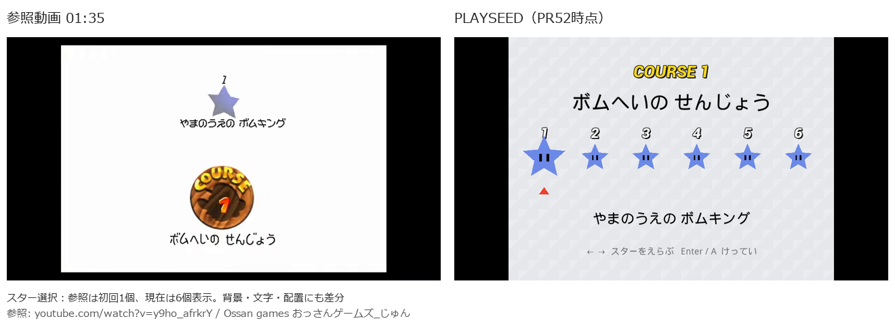

# 参照動画とPLAYSEEDの比較

参照は[Ossan games おっさんゲームズ_じゅんの動画](https://www.youtube.com/watch?v=y9ho_afrkrY)です。ブラウザーでフレームは確認できましたが画像保存ができなかったため、公開動画をログイン・Cookieなしの通常の読み取りで取得し、FFmpegで指定時刻の画像を書き出しました。動画本体はリポジトリに含めず、比較用の少数のフレームだけを使います。画像の内容を描き換える処理はしていません。

以下はPR52時点の比較です。残機・体力・コイン・総スターの値は別のプレイ記録によるため、同じ値へ加工していません。

|場面|参照時刻|現在の差分|
|---|---|---|
|絵への入場|1:30|正面の額と絵へジャンプする流れを実装。絵柄、額、部屋は自作の簡略版。局所的な波紋の変形は未実装|
|初回スター選択|1:35|参照は最初の1個のみ。現在は6個が横並び。背景色、COURSE表示の上下関係、文字の大きさにも差分|
|コース落下|1:36.5|上空から実重力で落下して着地する流れを実装。開始地点の案内役と砲台機能はまだ未配置|
|スター取得|3:47.75|参照はHUDを残し、正面のキャラクターが小さなスターを手に持つ。PR53でポーズ・カメラ・表示と絵前への自動帰還を接続中|
|杭とワンワン|14:00|地形、杭、格子、スターの位置と3回の操作を実装。モデルとアニメーションは独自実装。目・口・光沢、草と壁の素材の色や模様に差分|

地形は参照配置へ統合中です。現在の参照プレビューにはワンワン・杭・鉄格子・スター6が入り、山頂のボス、競走、砲台、浮島の箱、赤コイン8個、登り木と動く足場、空の輪と100枚分のコインは後続の作業です。全7報酬を新しい配置で同じ隔離セーブへ実取得する検証は、これらの統合後に行います。100枚コインのスターも取得後に絵の前へ戻るため、通常の赤コイン報酬とは別の入場で検証します。
