# 参照動画とPLAYSEEDの比較

参照は[ユーザー指定の動画](https://www.youtube.com/watch?v=y9ho_afrkrY)です。公開動画から少数のフレームを取り出して比較しています。動画本体はリポジトリへ含めません。比較画像の残機・コイン・スター・時間は各実プレイの値で、同じ値へ加工していません。

|場面|参照時刻|実装と残る差|
|---|---|---|
|絵への入場|1:30|正面の絵へ通常ジャンプし、ダイブ・白フェード・選択へ移る流れを実装。絵柄・額・部屋は自作簡略版。局所的な波紋変形は未実装|
|初回スター選択|1:35|初期1個、白背景、上段の番号/スター/目的名、下段COURSE/コース名。順番に取得すると次の1個、先の番号を取得するとその番号まで表示し、選べるのは取得済みと最初の未取得。書体とロゴ・立体表現は独自再現|
|コース落下|1:36.5|上空から実重力で落下し、着地後に操作を解放。開始地点の案内役と砲台を参照位置へ配置|
|山頂のボス|3:15|参照XYと初期向き、実床に合わせた大きい本体、背後から通常Eで持ち上げ/投げ、山頂へ3回の実着地で固定位置にスター1。手・ひげ・光沢・影に差|
|スター取得|3:47.75|HUDを残すポーズ、専用カメラ、小さい手持ちスター、白フェードと絵前帰還を実装。実保存失敗/再接触保存/復元も検証。レース相手の甲羅がポーズを遮る不具合をPR59でカメラ専用判定により修正|
|山頂レース|4:35|相手の開始位置・36地点経路・旗と報酬位置を配置。通常G開始、実走行と旗到着、相手待ち、G勝利会話、スター2取得。上段の4色TIMEと自分の到着時刻の停止表示。字形・旗模様・モデルと影は自作簡略版|
|大砲と浮島|6:30 / 6:40|6砲台と案内役を参照位置へ配置。通常Gの会話と保存で開通、G搭乗・マウス照準・左クリックの実発射で浮島へ着地。黄色箱へ通常ジャンプで頭突きしてスター3取得。丸い照準枠と4方向マークを実装。素材・雲・モデルは自作簡略版|
|赤コインと足場・木登り|7:20 / 10:00|元位置の赤8枚と固定スター4、原寸のシーソー橋、上下と半回転する2枚の足場、F/Wで登れる17本の木を配置。実接地・ジャンプ・大砲・木登りで8枚を回収し取得保存・帰還を確認。厚い葉の遮蔽を薄いカメラ向きの葉へ修正。赤コインの色・軸の円形部品・素材と木の形は調整が残る|
|羽根帽子と空の輪|12:40 / 12:53|参照位置の赤箱3個、実頭突きと実帽子取得、60秒の力、5輪の中央と外周の実45コイン。通常G/マウス/左クリックの大砲と飛行で中央5枚から固定スター5を生成。入口の赤スイッチは小さい一コース構成への置換。飛行姿勢・雲・素材と形に差|
|地上の金コインと木の杭|10:40|元位置の金3列と輪8枚、木の杭4本、3コイン木箱。普通の箱攻撃/3周/実接触で地上36枚を回収し、Rでスコア0とコイン/箱/杭を復元。山道と高台の残り10枚もPR65の100枚入場で実回収|
|100枚の追加スター|ユーザー指定の追加要件|正規1〜6の同じ実セーブから、地上36/赤8/山道と高台10/帽子と大砲/空の金コインで100へ到達。スター7を1個だけ生成し、取得保存・ポーズ・白フェード・絵前帰還と別プロセスの全7個読み込みを確認。参照動画の特定場面と同一とする比較ではない|
|鉄球のくぼ地と山道|2:25|山道の上下18/27点経路とくぼ地の元3地点へ自作の黒い鉄球を配置。目的1はくぼ地2個、以降は3個。実接触で2ダメージと押し戻し、Rで全5個とHP/入口を再開。山道は実床に合わせて下り加速、くぼ地は実床の連続周回という自作の動作。光沢・地面や背景の素材に差|
|両開き柵と紫スイッチ|公開一次資料の配置・寸法|柵(-2050,3069,0)、スイッチ(-2283,3682,0)。実格子が歩行を止め、実上面に立つと2枚が約2.13秒で横へ開く。普通の通行とRによる再閉鎖/再作動を確認。形・材質は自作|
|4地点のワープ|公開一次資料の対応|山下(583,5387,2683)と山上(1680,5523,3835)、西側(-6612,3351,1024)と野原(1980,-6618,768)。2組の実往復、2.2秒の到着待ちで往復暴発なし、実退出/再入場、移動先へカメラの原点を更新|
|回転ハート|公開一次資料の配置と挙動|自作赤ハート(3603,7070,3659)。実被弾後の普通の接触で回転し、実回転ごとに通常の体力回復で8へ。主人公の体力をQAから設定しない|
|水玉大砲|公開一次資料の配置と挙動|野原側は目的1のみ、パラメータ1で非発射。山側は常設で自動照準/直進発射。通常歩行/実ジャンプで訪れ、2発以上と観察中のHP不変、R/M帰還を確認。水玉は当たり判定なし。外観と運動は自作|
|落下する水玉|公開一次資料の配置|元3地点と範囲950/1450/700cmを配置。実プレイヤーの少し先へ出現元+2000cmから落下し、床への球スイープ・実接触で1ダメージと押し戻し。2回跳ねる水玉/実床に追従する影、普通の移動とカメラでの回避、Rによる全3地点の初期化を確認。形・素材・運動は自作。水玉大砲は後続|
|杭とワンワン|14:00|地形・杭・格子・スター6の位置、3回ヒップドロップ、解放した相手の実Sweepによる格子破壊。目・口・光沢や素材に差|

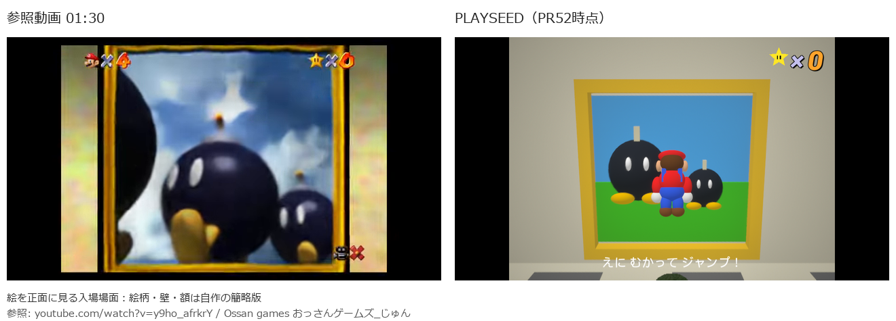

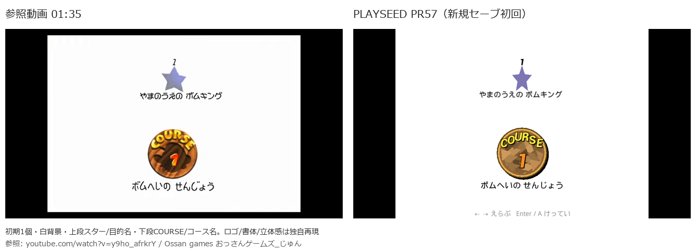

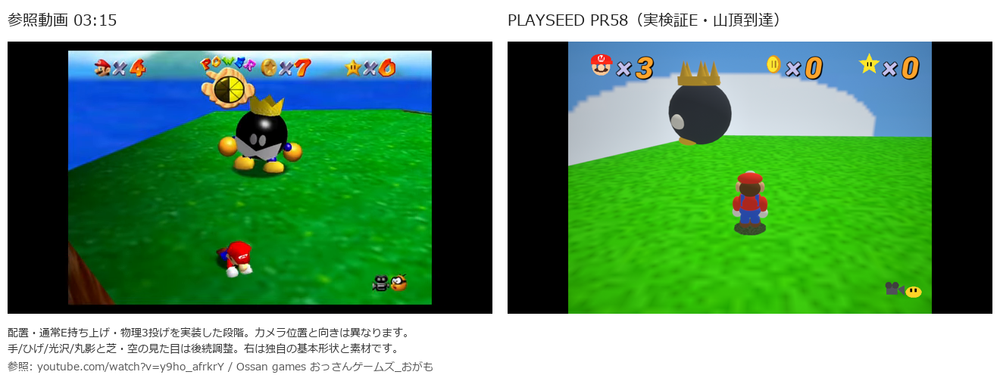

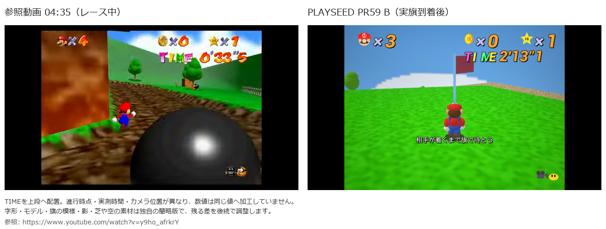

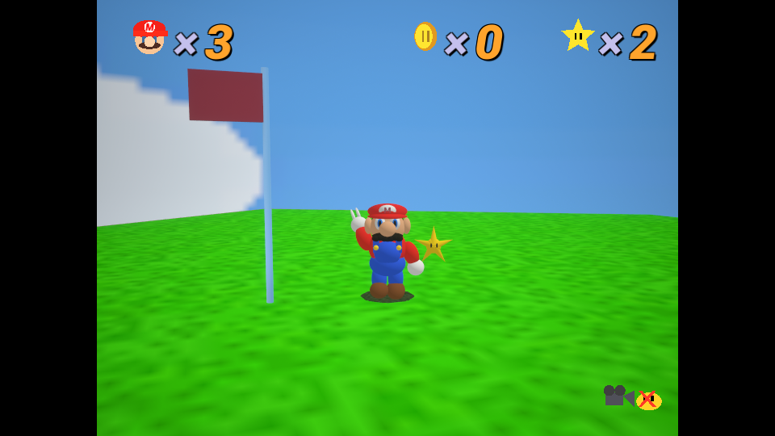

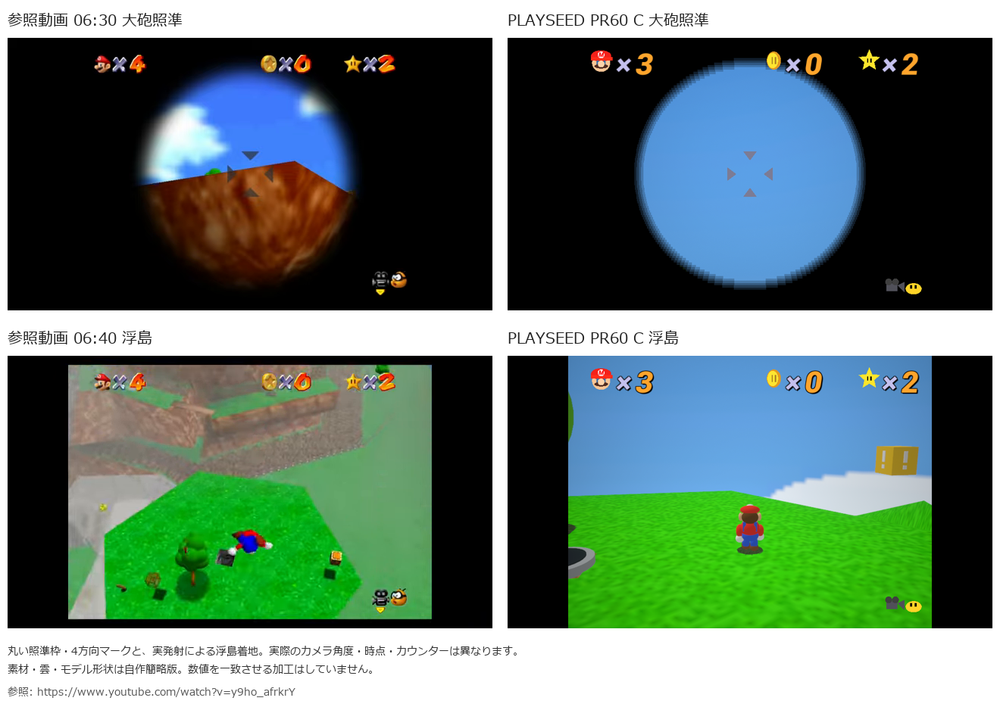

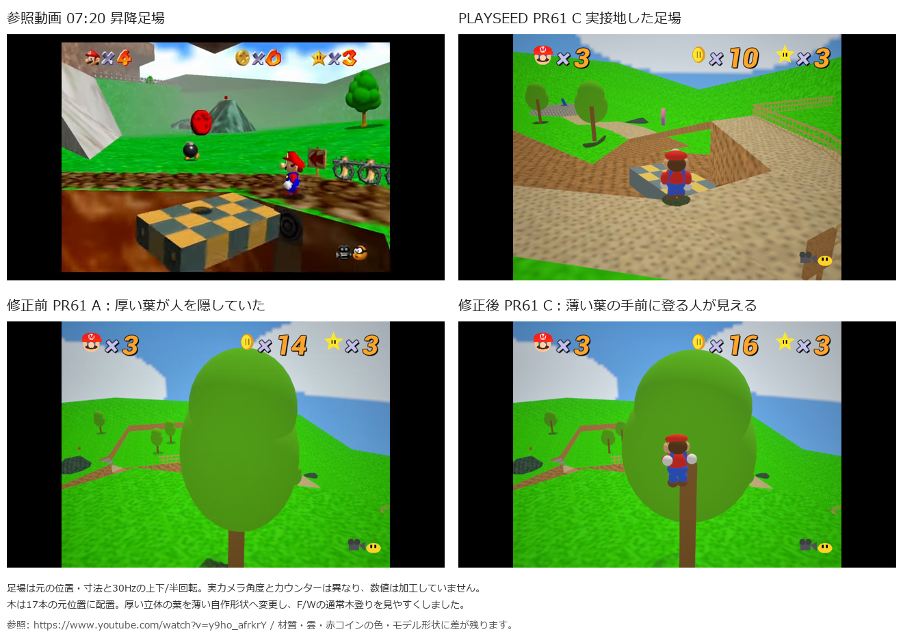

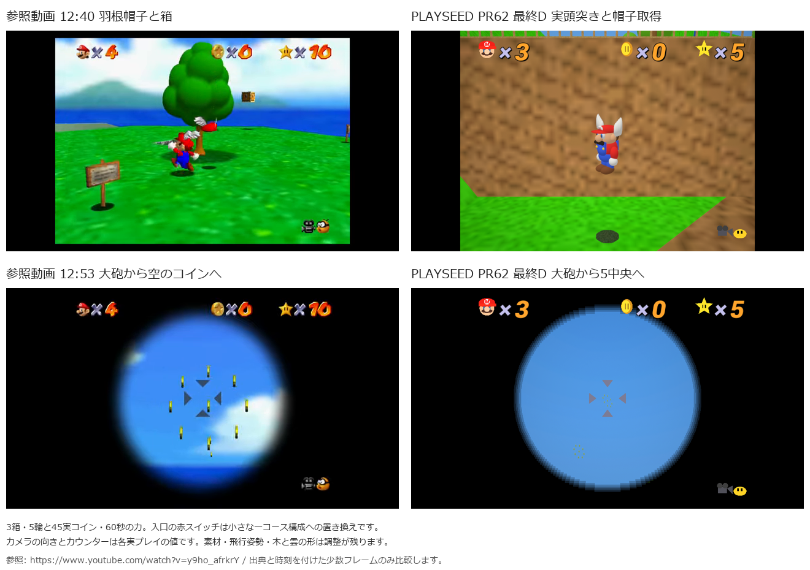

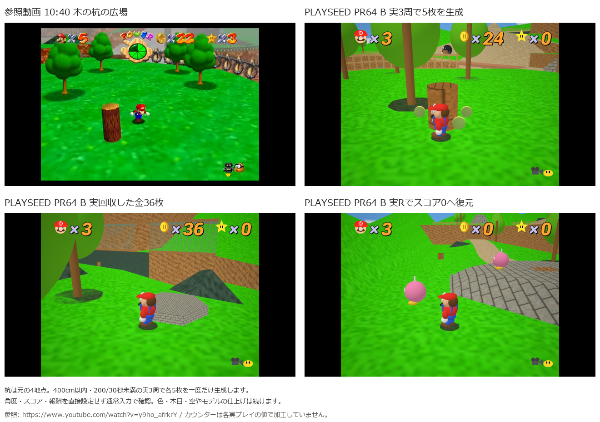

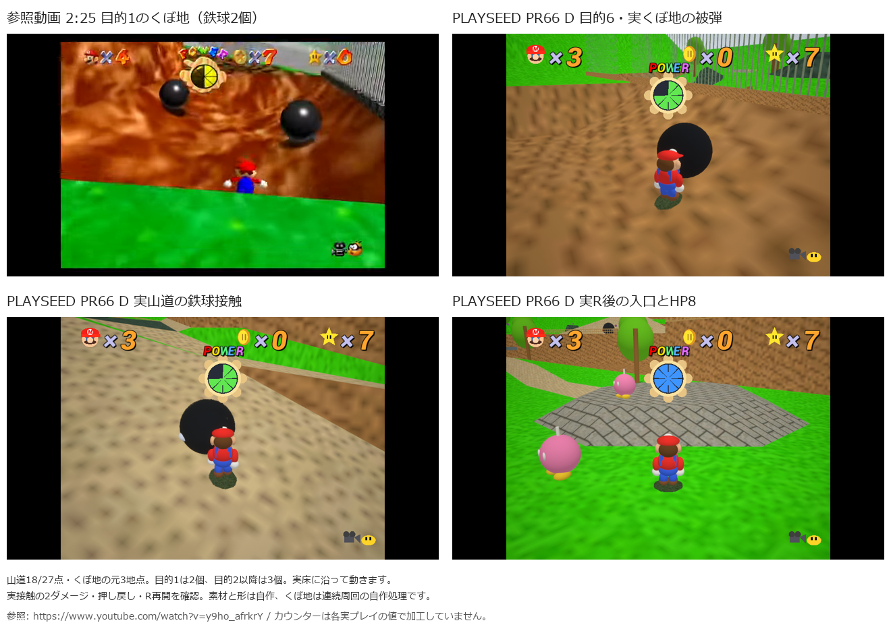

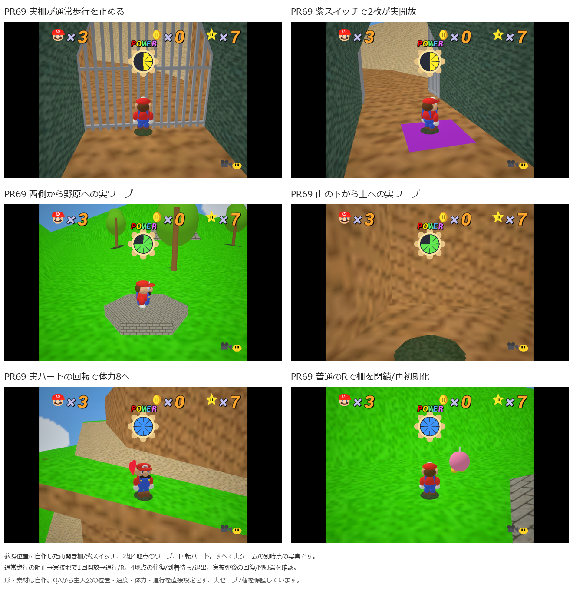

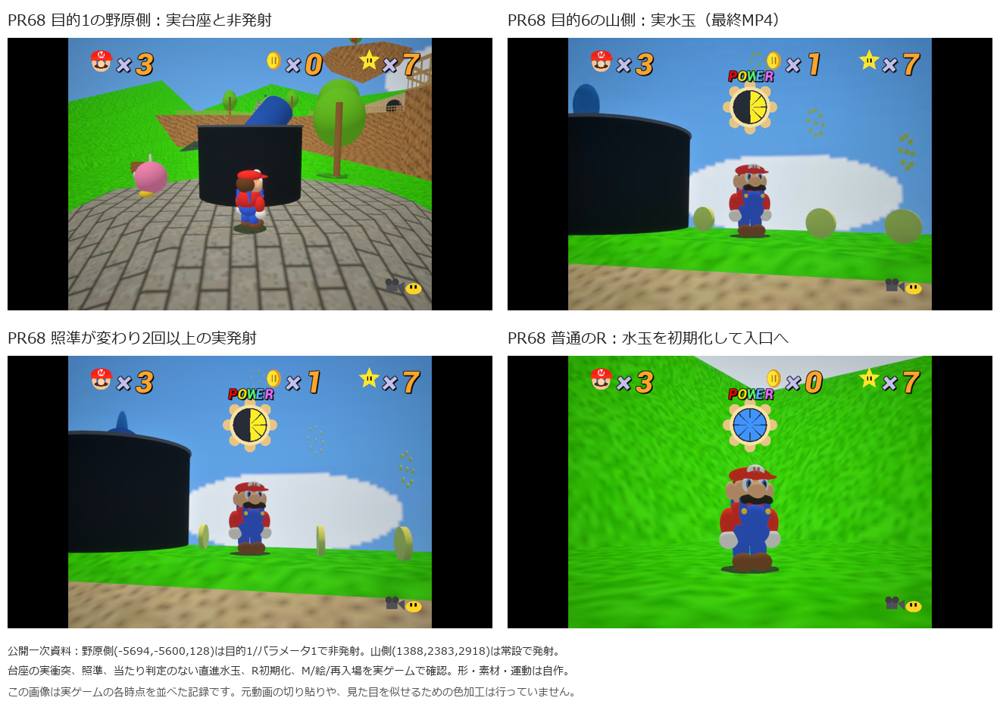

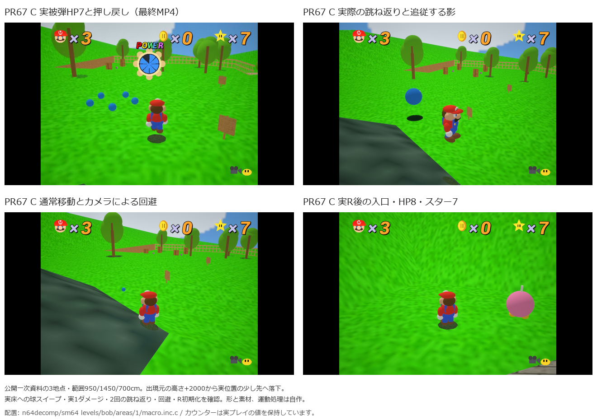

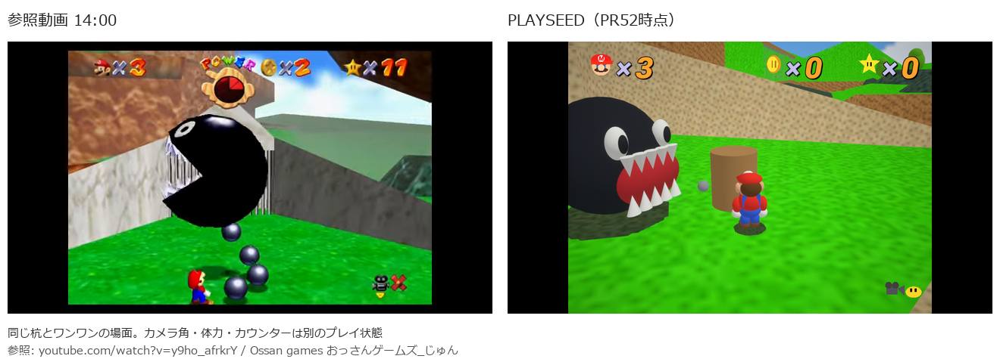

現行コースにはボス1、レース2、大砲/浮島の箱3、赤コイン/木/足場4、帽子/空の輪5、ワンワン/杭/格子6、100枚7が入り、全7個の実取得と絵前帰還を段階的に検証しました。1・2はPR59最終コードの同じ新規検証スロット、PR60で3、PR61で4、PR62初回Bで5、PR65で6と100枚7を順に実取得しました。別プロセスでその同じ実セーブを読み、全7個と選択の主6個獲得済みを確認しています。通常起動はPR63で絵の入口と現行コースへ切り替え、Play.cmdをダブルクリックして遊べます。鉄球はPR66で追加し、くぼ地と山道の実被弾・R再開・絵前帰還を確認しました。落下水玉はPR67で実被弾/回避/R初期化を確認しました。水玉大砲はPR68で実発射/Rを確認しました。ショートカット・回復はPR69で実接触を確認しました。敵、芝・壁・空やキャラクターの素材/形は継続作業です。

全7報酬を最終コードの新規同一セーブへ実取得する検証は未実施です。100枚スターも取得後は絵前へ帰還するため、通常の赤コイン報酬とは別の入場で検証します。最後に別プロセスで7個の読み込み、実死亡後の保持、獲得済みスターの再取得も確認します。

選択規則は[公開一次ソース](https://github.com/n64decomp/sm64/blob/master/src/menu/star_select.c)、レースの報酬位置は[公開一次ソース](https://github.com/n64decomp/sm64/blob/master/src/game/behaviors/koopa.inc.c)も確認しました。
落下水玉の配置は[公開一次資料](https://github.com/n64decomp/sm64/blob/master/levels/bob/areas/1/macro.inc.c)、落下・接触・影は[公開挙動](https://github.com/n64decomp/sm64/blob/master/src/game/behaviors/water_bomb.inc.c)を参考にしました。

水玉大砲は[公開挙動](https://github.com/n64decomp/sm64/blob/master/src/game/behaviors/water_bomb_cannon.inc.c)と[配置](https://github.com/n64decomp/sm64/blob/master/levels/bob/script.c)を参考にしました。

開閉柵は[公開挙動](https://github.com/n64decomp/sm64/blob/master/src/game/behaviors/grill_door.inc.c)、ワープは[参照配置](https://github.com/n64decomp/sm64/blob/master/levels/bob/script.c)、回転ハートは[公開挙動](https://github.com/n64decomp/sm64/blob/master/src/game/behaviors/recovery_heart.inc.c)を参考にしました。
